<div align="center">

<h1>HostOps</h1>

<p>A terminal dashboard for VPS discovery, website health, resource monitoring and AI review exports.</p>

<p>
  <strong>
    <a href="#1-getting-started">Getting started</a> ·
    <a href="#2-dashboard-views">Dashboard views</a> ·
    <a href="#12-documentation">Documentation</a> ·
    <a href="SECURITY.md">Security</a>
  </strong>
</p>

</div>

---

## 1. Getting started

**Windows — PowerShell**

```powershell
irm https://raw.githubusercontent.com/Shumair99/host-ops/main/scripts/install-latest.ps1 | iex
hostops start
```

**Linux / macOS**

```sh
curl -fsSL https://raw.githubusercontent.com/Shumair99/host-ops/main/scripts/install-latest.sh | bash
export PATH="$HOME/.local/bin:$PATH"
hostops start
```

The installer downloads the latest release for your computer and verifies its checksums. Installation requires no Go, Docker or administrator access.

| Requirement | Supported configuration |
| --- | --- |
| Computer | Windows, Linux or macOS; amd64 or arm64 |
| VPS | Linux; amd64 or arm64 |
| Connection | OpenSSH with an SSH key or agent; password-only login is unsupported |

First launch:

1. Enter the VPS SSH address or a saved SSH alias.
2. Verify the SSH connection.
3. Review the detected server configuration.
4. Configure optional history collection and billing, or skip them.

Later launches use the saved connection. See [installation and SSH setup](docs/install.md) for manual downloads, custom paths, updates and uninstall.

> **Not published yet:** these commands become available once the GitHub repository is public and its first downloadable release has been published.

---

## Contents

1. [Getting started](#1-getting-started)
2. [Dashboard views](#2-dashboard-views)
3. [Operations tools](#3-operations-tools)
4. [Navigation](#4-navigation)
5. [Monitoring and discovery](#5-monitoring-and-discovery)
6. [Export for AI](#6-export-for-ai)
7. [Optional setup](#7-optional-setup)
8. [Collection and data storage](#8-collection-and-data-storage)
9. [Command-line commands](#9-command-line-commands)
10. [Offline demo](#10-offline-demo)
11. [Build from source](#11-build-from-source)
12. [Documentation](#12-documentation)
13. [Contributing and security reports](#13-contributing-and-security-reports)
14. [License](#14-license)

---

## 2. Dashboard views

Screenshots use the offline demo: Example Site A–F, fictional measurements and no VPS connection.

### 2.1 Overview

1. CPU, memory and disk histories.
2. Website health, response times and workload pressure.
3. Operations feed with current notices above recent activity.

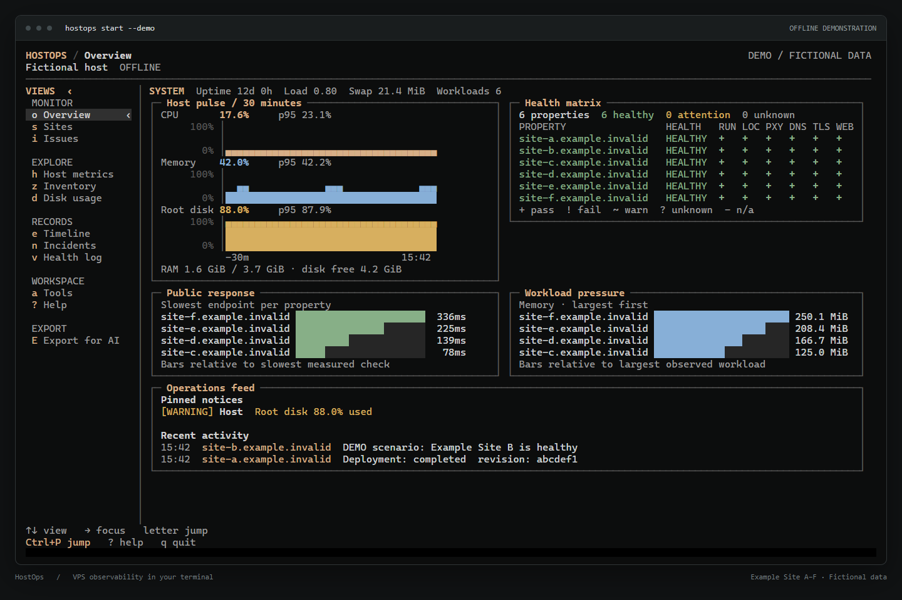

### 2.2 Sites

1. Related domains grouped under the main property.
2. Site inspector with runtime, proxy route, running revision and health checks.
3. Separate checks and resource measurements for each related endpoint or workload.

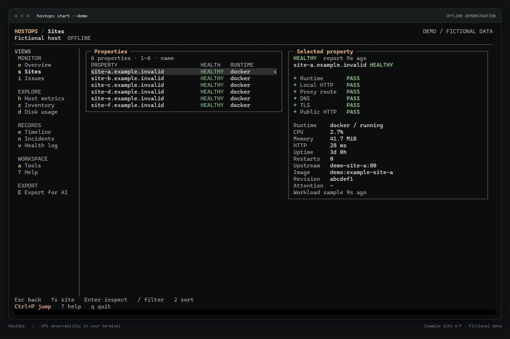

<details>
<summary><strong>Site inspector screenshot</strong></summary>

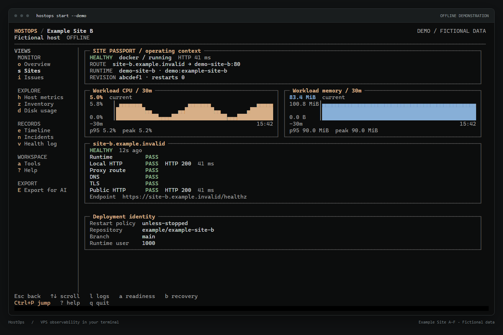

</details>

Confirmed main-domain/`www` redirects share an application readiness assessment. Independent applications retain separate workloads and assessments. Domain tables place main-domain/`www` pairs next to each other.

### 2.3 Issues

1. Current failures and warnings.
2. Missing evidence and diagnostic findings.
3. Supporting checks and confidence for each diagnosis.

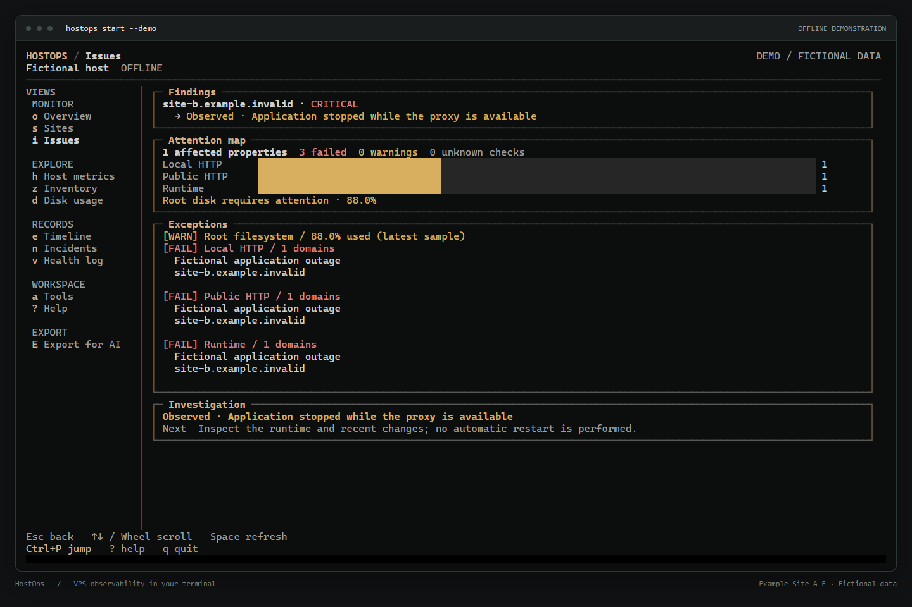

### 2.4 Host metrics

1. CPU, memory, swap, load and kernel pressure.
2. Filesystem capacity.
3. Network traffic, packet counts, errors and drops.

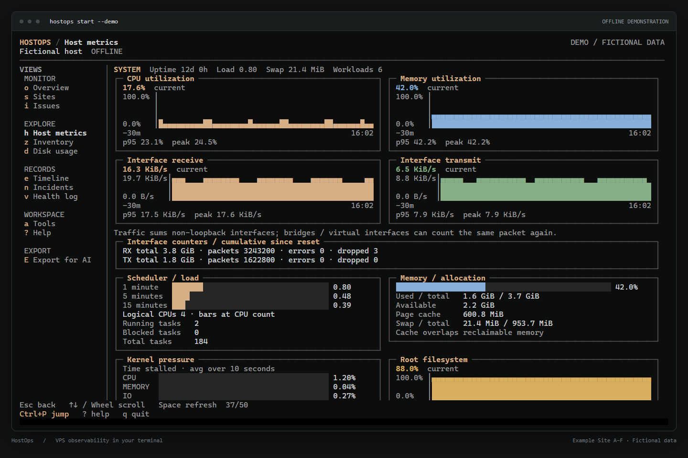

### 2.5 Inventory

1. Discovered domains, routes, workloads and listeners.
2. Sources used to collect each observation.
3. Collection coverage and unresolved mappings.

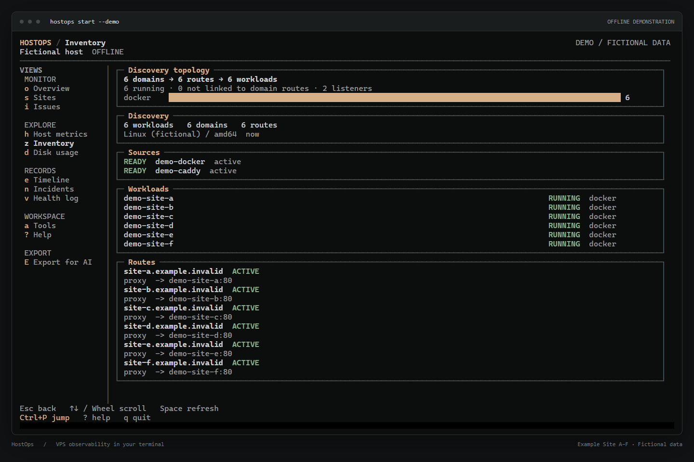

### 2.6 Disk usage

1. Navigable directory index and filesystem totals.
2. Attributable site storage.
3. Docker storage accounting.

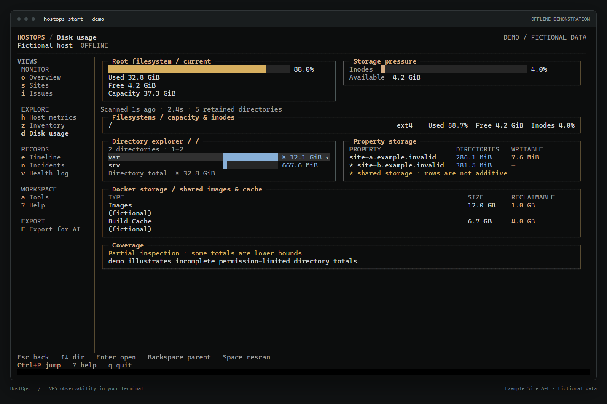

### 2.7 Timeline

1. Health transitions.
2. Deployment and infrastructure changes.
3. Incident activity.

<details>
<summary><strong>Timeline screenshot</strong></summary>

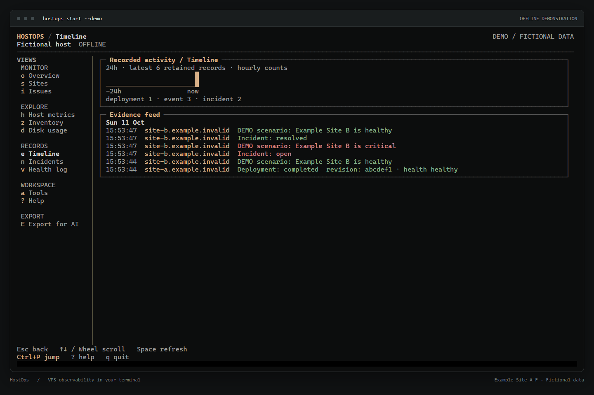

</details>

### 2.8 Incidents

1. Saved outage evidence and investigation details.
2. Recovery status with the original symptoms retained.
3. JSON incident capsule export.

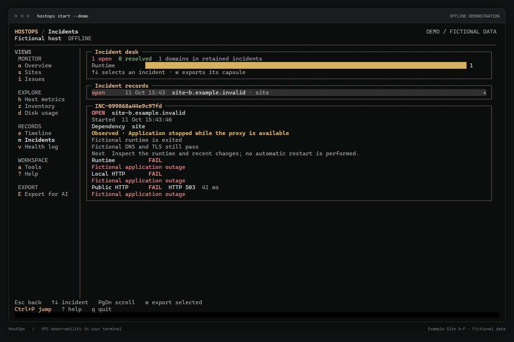

<details>
<summary><strong>Resolved incident screenshot</strong></summary>

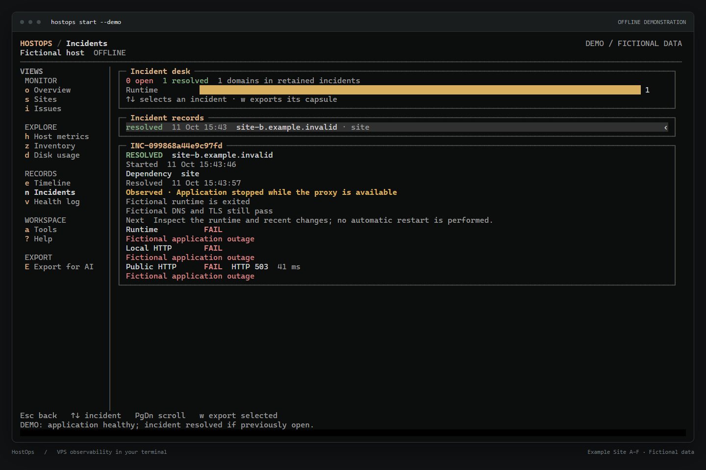

</details>

### 2.9 Health log

1. Independent observations for each address.
2. DNS, TLS and public HTTP results.
3. Separate main-domain and `www` checks, including redirects.

<details>
<summary><strong>Health log screenshot</strong></summary>

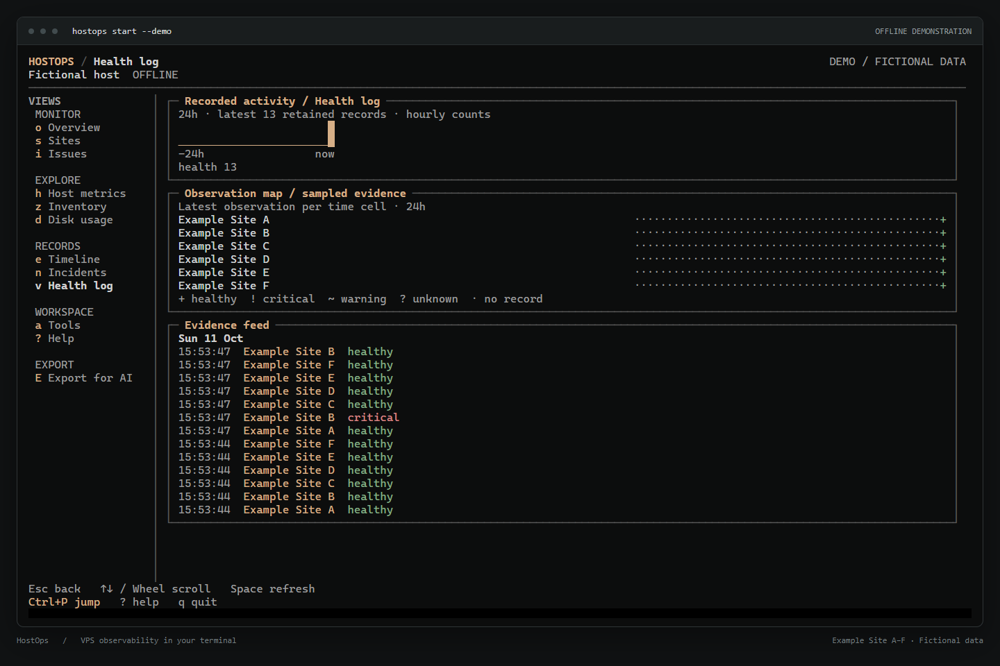

</details>

---

## 3. Operations tools

| No. | Tool | Information |
| --- | --- | --- |
| 3.1 | **Security** | Process permissions, container isolation, memory limits, image versions and exposed ports |
| 3.2 | **Capacity** | Remaining capacity, recent usage peaks and disk pressure |
| 3.3 | **Impact** | Shared hosts, proxies, workloads, networks and storage, with evidence for each relationship |
| 3.4 | **Readiness** | Recorded availability, deployment, recovery, hardening and monitoring evidence |
| 3.5 | **Recovery** | Detected backup artifacts and reported backup/restore outcomes against recovery targets |
| 3.6 | **Preflight** | Startup, health, capacity and recovery checks before maintenance or reboot |
| 3.7 | **Changes** | Recorded deployment and infrastructure changes |
| 3.8 | **Deployments** | Imported deployment results and running code revisions |
| 3.9 | **External watcher** | Public health checks reported from another computer |
| 3.10 | **Costs / setup** | Billing settings and estimated site costs based on CPU, RAM and disk capacity |

Assessment meanings:

1. **Readiness:** evidence coverage. A working site can score lower when backup, revision or monitoring evidence is missing.
2. **Security:** observed settings to review. A warning is not proof of an exploitable vulnerability.
3. **Unknown:** evidence is missing, unavailable or stale.
4. **Preflight:** checks the recorded state; performs no maintenance.
5. **Impact:** labels observed connections, declared dependencies and shared networks separately.

See the [operations tools guide](docs/operations-tools.md) for assessment rules and limitations.

---

## 4. Navigation

| Setting | Recommendation |
| --- | --- |
| Minimum terminal size | 60 columns × 16 rows |
| Recommended terminal size | 120 columns × 36 rows or larger |
| Windows terminal | Windows Terminal with Cascadia Mono or Consolas |

| Control | Action |
| --- | --- |
| Up / Down | Select a list item or scroll evidence; selectable lists wrap at either end |
| Enter / Right | Focus a view, open an inspector or select an action |
| Esc | Go back one level or cancel an input/confirmation |
| Left / Tab / Shift+Tab | Move between Views and content |
| Mouse wheel | Scroll the pane under the pointer or move through its list |
| PageUp / PageDown; Home / End | Move through the focused list or document |
| Ctrl+P | Search for a view or property |
| Space / F5 | Refresh the current view / request inventory and health refresh |
| `?` / `q` | Open Help / quit |

1. View shortcuts appear beside their names in the menu.
2. The sidebar and setup actions support mouse clicks.
3. Use `--color never` or `NO_COLOR` for monochrome output. Status labels remain visible.

See the [terminal guide](docs/terminal-guide.md) for the complete keyboard map.

---

## 5. Monitoring and discovery

### 5.1 Collection intervals

| Observation | Default interval |
| --- | --- |
| Host CPU, RAM, swap, load and uptime | 1 second |
| Workload metrics, inventory and root filesystem capacity | 30 seconds |
| Public HTTP response | 30 seconds; configurable with `--interval` |
| DNS, TCP reachability and TLS | 5 minutes |
| Saved host resource samples used by charts | 15 seconds |

1. Numeric readings can update between saved chart samples.
2. Chart bars and time windows advance when saved samples arrive.
3. Missing measurements remain blank; they are not treated as zero.
4. `PROPAGATING.` / `..` / `...` indicates the initial load. Routine refreshes retain completed evidence without restarting the animation.

### 5.2 Health checks and diagnoses

1. Separate checks cover application runtime, local HTTP, proxy routing, DNS, TLS and public HTTP.
2. Diagnostic findings retain supporting facts and use **Observed**, **Likely** or **Unconfirmed** confidence labels.
3. A failed request without an established cause remains unconfirmed.
4. Optional RDAP lookups can report registry holds and expiration dates for failing public endpoints.
5. RDAP requests send the registrable parent domain to IANA and the relevant registry. Requests are bounded and cached; registry evidence cannot establish domain ownership.
6. Set `HOSTOPS_NO_RDAP=1` to disable registry lookups.

See [diagnostics](docs/diagnostics.md) and [monitoring](docs/monitoring.md).

### 5.3 Supported discovery sources

| Source | Supported observations |
| --- | --- |
| Docker / Podman | Runtime and workload metadata |
| Linux / systemd | Listeners, processes and services |
| Caddy / Nginx / Traefik | Proxy routes and configuration |
| Apache | Explicit virtual hosts |

1. Route matching uses observed addresses, network-scoped aliases, sockets and published ports.
2. Active proxy configuration takes precedence over declared configuration when both are available.
3. Collection depends on the connected account's access. Rootless Podman exposes that user's inventory.
4. Unsupported proxies, inaccessible runtime sockets, ambiguous aliases, wildcard hosts and opaque dynamic routing are reported as coverage gaps.
5. Inventory snapshots cannot establish every idle, remote or dynamically generated dependency. Some reboot checks remain Docker/Caddy-specific.
6. Supported VPS architectures are Linux amd64 and arm64. Inventory lists the sources available on the connected server.

See the [discovery guide](docs/discovery.md) for reader coverage and limitations.

---

## 6. Export for AI

1. Select **Export for AI** at the bottom of Views.
2. Press **Enter** to review the destination and contents.
3. Press **P** to change the folder if needed. The default is `~/HostOps/exports`.
4. Press **Enter** again to confirm, or **Esc** to cancel.
5. Review the saved Markdown before sharing it with an AI.

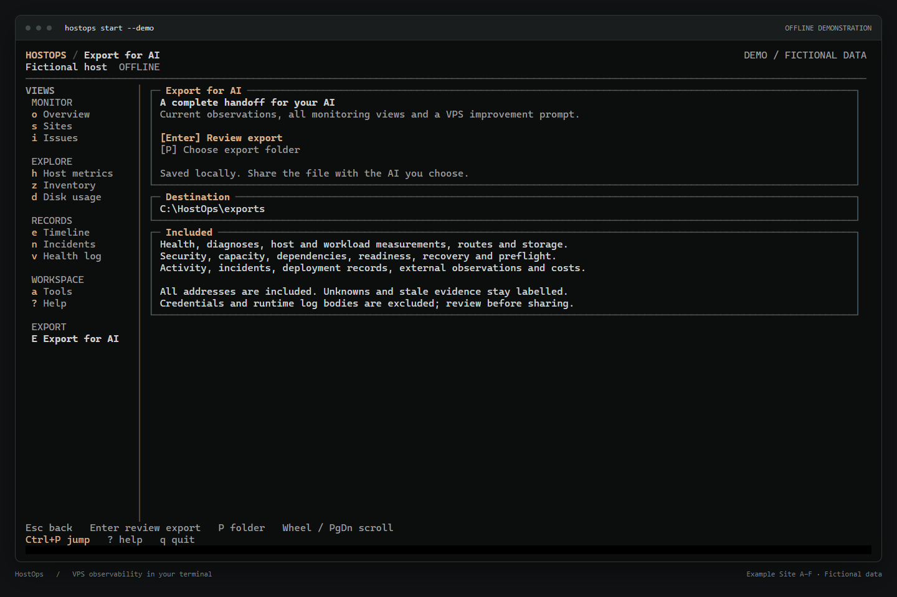

Command-line export:

```sh
hostops export-ai --output server-review.md
hostops export-ai --demo --output demo-review.md
```

| Export component | Contents |
| --- | --- |
| Identity index | Domains and services |
| Evidence | Normalized facts, relationships and assessments |
| History | Records and metric histories within the retained export windows |
| Review prompt | Issues by domain/service, prioritized VPS and deployment improvements, verification and rollback steps |

1. Passing, failing and unknown evidence is included, regardless of the selected view or filter.
2. Identical facts are referenced once; subjects and view membership remain explicit.
3. Capture times and history coverage are stated in the export.
4. SSH credentials, environment values, raw configuration dumps and runtime log bodies are excluded. Recognized secret patterns are redacted.
5. Domains, addresses, paths, billing figures and imported free text can still be private.
6. The file is saved locally. HostOps does not submit it to an AI.

See [export contents, limits and privacy](docs/ai-export.md).

---

## 7. Optional setup

### 7.1 Billing

1. Open **Costs / setup** and press **Enter / S**.
2. Enter the monthly amount and select GBP, EUR or USD. Alternatively, connect a supported Hetzner server or Hostinger subscription through read-only API requests.
3. API tokens remain in the environment or dashboard session; they are not saved in settings or history.

Cost calculation:

1. Site CPU, RAM and attributable storage are compared with total server capacity.
2. Default weights are equal thirds. Shared or unmeasured storage remains unassigned.
3. Incomplete estimates are labelled partial. Spare capacity is shown separately.
4. Estimates allocate costs; the full hosting bill remains payable.

See [billing and cost calculation](docs/economics.md).

### 7.2 Backup and restore evidence

1. Open **Recovery** and press **S** to import a backup/restore JSON report or scan existing backup artifacts.
2. Detected files establish artifact presence. Successful backup and isolated restore reports provide separate outcome evidence.
3. Backup jobs can write validated reports under `~/.local/state/hostops/recovery/` on the VPS for automatic collection.
4. Default recovery targets are 24 hours of acceptable data loss and 15 minutes to restore service.

See [backup detection and report formats](docs/recovery.md).

### 7.3 Deployment records and external checks

1. Use **Enter / S** on **Deployments** or **External watcher** to import reports, or use `hostops record`.
2. Run `hostops-watcher` on a separate computer to check public availability independently.

See [deployment reports](docs/deployments.md) and [external watcher setup](docs/watcher.md).

---

## 8. Collection and data storage

### 8.1 SSH collector

1. A persistent SSH session runs the bundled collector from the remote user's private cache.
2. The collector opens no management listener and exits when the session ends.
3. Collection reads supported metadata and metrics. It does not restart services, reload proxies, change deployment permissions or prune resources.
4. Disk inspections are bounded and cached. The Disk usage view provides measurements for cleanup decisions.

### 8.2 Optional VPS history service

1. Installation requires explicit consent and root/sudo authorization. Pressing Enter in onboarding keeps it disabled.
2. The service runs under a dedicated non-root account with no Linux capabilities.
3. It retains a bounded 30-minute host-metric history and exposes only a local Unix socket.

```sh
hostops agent status
hostops agent install
hostops agent uninstall
```

### 8.3 Background workstation collection

1. Run `hostops-agent` separately against the same configuration and database to collect while the dashboard is closed.
2. Open the dashboard with `--no-collect` to read that collector's observations.
3. Use one active collector per database.

See [background collection options](docs/terminal-guide.md#optional-background-collector-and-plain-commands).

### 8.4 Local files and retention

| Local data | Default location |
| --- | --- |
| Connection settings | OS user configuration folder, under `HostOps/hostops.json` |
| SQLite history | OS user cache folder, under `HostOps/history.db` |
| AI exports | `HostOps/exports` in the home directory |

1. Custom settings: `--config FILE`, `HOSTOPS_CONFIG` and existing `hostops.json` / `local/hostops.json` files are supported.
2. Multiple servers: use separate configuration files. Use `--db FILE` for a specific history location.
3. File access: settings and history use restrictive permissions. Windows refuses shared custom history directories.
4. Database budget: 256 MiB by default. Sidecars and migrations require additional disk space.
5. Resource history: detailed samples for 24 hours, five-minute summaries through day 7, and thirty-minute summaries through day 30.
6. Other history: health/inventory evidence defaults to 7 days; operational evidence defaults to 365 days.
7. Storage pressure can shorten older history. Updates and workstation uninstall retain personal settings, history and exports.

See [history policy](docs/history.md) and [storage inspection](docs/storage.md).

### 8.5 Security boundaries

1. HostOps relies on the configured server to report its state honestly.
2. Docker access carries substantial host privileges, including when used for inspection.
3. Security findings assess observed settings and permissions; they do not certify the whole server's security.

See [security boundaries](docs/security.md) before connecting or sharing evidence.

---

## 9. Command-line commands

Most query commands print readable text. Add `--json` for integrations. Run `hostops help` for all commands and options.

```sh
hostops discover --json
hostops sites --no-collect --json
hostops doctor
hostops metrics --history --since 24h --json
hostops readiness
hostops security
hostops recovery
hostops preflight reboot
hostops impact caddy
hostops dashboard --once --no-collect --page overview --color never
```

Evidence imports:

```sh
hostops record deployment --file deployment.json
hostops record backup --file backup.json
hostops record restore --file restore.json
```

1. Site-scoped commands accept the stable site ID from `hostops sites`.
2. Imports validate host/site scope, chronology and known fields.
3. `--no-collect` disables automatic collection. Inspection views can still perform requested live reads.

| Exit code | Meaning |
| --- | --- |
| 0 | Successful list or healthy result |
| 1 | Usage or configuration error |
| 2 | Unhealthy or unknown assessment |

---

## 10. Offline demo

```sh
hostops start --demo
```

1. Uses fictional sites and an isolated in-memory database.
2. Makes no network requests.
3. Press **t** to simulate an outage or recovery and inspect the resulting incident.
4. Exports write a local file only when requested.

Print a single frame:

```sh
hostops start --demo --once --color never
```

The [demo guide](demo/README.md) also documents a disposable Docker/Caddy setup for testing discovery.

---

## 11. Build from source

### 11.1 Tests and local run

Requires **Go 1.27.2 or newer**, as specified in [go.mod](go.mod). Run from a clone of the repository:

```sh
go test -count=1 ./...
go vet ./...
go build ./...
go run ./cmd/hostops start --demo
```

### 11.2 Installable bundles

Windows:

```powershell
./scripts/build-bundles.ps1 -Version preview
# Optional: build one workstation target
./scripts/build-bundles.ps1 -Version preview -Targets windows-amd64
```

Linux / macOS:

```sh
bash scripts/build-bundles.sh --version preview
# Optional: build one workstation target
bash scripts/build-bundles.sh --version preview --targets linux-amd64
```

1. Archives and `SHA256SUMS` are written to `output/bundles`.
2. Bundles include installers, executables, both remote helper architectures, public guides, examples and build metadata.
3. Installers verify file checksums before switching versions. Checksums establish integrity; authenticated release provenance is a separate publishing concern.

See [build and installation details](docs/install.md#building-distributable-packages).

### 11.3 CI and systemd lab

1. [CI](.github/workflows/ci.yml) runs Windows/Linux tests, vet, builds and Go vulnerability checks.
2. Linux checks also cover race/fuzz tests, storage fixtures, packaging and installation.
3. The systemd lab tests the optional service in a disposable privileged container with no published ports or host-directory mounts.
4. Installer smoke tests use isolated profiles and installations.

Run the lab on a development computer with Docker:

```sh
bash scripts/linux-lab.sh
```

Do not run the lab's lifecycle test directly on a production VPS.

---

## 12. Documentation

| No. | Subject | Guides |
| --- | --- | --- |
| 12.1 | Installation and use | [Install and update](docs/install.md), [Terminal guide](docs/terminal-guide.md), [Offline demo](demo/README.md) |
| 12.2 | Discovery and monitoring | [Discovery](docs/discovery.md), [Monitoring](docs/monitoring.md), [Diagnosis](docs/diagnostics.md) |
| 12.3 | Assessments | [Operations tools](docs/operations-tools.md), [Readiness](docs/readiness.md), [Preflight and Impact](docs/preflight.md) |
| 12.4 | Operational evidence | [Recovery](docs/recovery.md), [Deployment reports](docs/deployments.md), [Changes](docs/changes.md), [Incidents](docs/incidents.md) |
| 12.5 | Storage and costs | [Storage](docs/storage.md), [History](docs/history.md), [Costs](docs/economics.md), [External watcher](docs/watcher.md) |
| 12.6 | Export and security | [AI export](docs/ai-export.md), [Security boundaries](docs/security.md), [Exposure checks](docs/exposure.md), [Deployment assessment principles](docs/deployment-principles.md) |

---

## 13. Contributing and security reports

1. Bug reports: include the version, platform, reproduction steps and relevant coverage messages.
2. Examples: use fictional or redacted data. Keep credentials, private inventories and exported server reviews out of public issues.
3. Changes: preserve existing integrations and distinguish measured facts, inferred causes and unavailable evidence.
4. Vulnerabilities: follow [SECURITY.md](SECURITY.md) and use private reporting when available.

---

## 14. License

[MIT](LICENSE).
