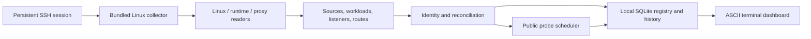

# Automatic VPS discovery

HostOps uses one observation pipeline. Linux/runtime/proxy readers contribute different facts to a shared graph; the reconciler is the only component that turns those facts into sites. A reader failure becomes source coverage evidence. It does not select another discovery system or guess folder names.



## Connection and packaging

```powershell
.\bin\hostops.exe connect ops@vps --identity C:/Users/me/.ssh/id_ed25519
.\bin\hostops.exe dashboard
.\bin\hostops.exe discover --no-collect
```

The identity flag is optional. `--port 2222` supports custom SSH ports, and an SSH alias can supply details through your existing SSH configuration. Password prompts are disabled and host-key checking is strict. Establish trusted SSH access before connecting.

The client reads the server architecture, chooses the matching Linux AMD64/ARM64 collector beside the executable, uploads it with a SHA-256 check, and launches `collect` over SSH stdin/stdout. The private cache is `${XDG_CACHE_HOME:-$HOME/.cache}/hostops`, with owner-only permissions. This writes an executable without installing packages, a service, a scheduled task or a listening port. Quitting cancels the session. Content-addressed executables remain cached. `discovery.collector_file` or `connect --collector FILE` can select an explicit matching executable.

Linux local mode uses the same collector/protocol when `host.ssh` is omitted. Windows is a client for Linux discovery. Other server operating systems and architectures are outside this bundle.

## Facts and identity

Sources retain kind, time, availability, active/configured mode and explanation. Workloads retain stable IDs, instance IDs, Compose identity where present, state, selected image/revision/restart facts, network addresses/aliases, ports and mounts. Listening sockets connect host addresses or Unix sockets to services/processes. Routes retain host/path matchers, upstreams, static roots, redirects, proxy identity and source identity.

Names/addresses are matched only in the proxy's reachable networks. An exact observed container name or address takes precedence over generic aliases. A generic alias must identify exactly one workload across those networks; ambiguity leaves the route unresolved instead of attributing resources to unrelated tenants. This can expose a previously misleading green property as unknown until its actual upstream is uniquely identifiable. Real multiple backends retain per-backend checks; a single runtime passport is populated only when one owner exists.

Default systemd/process inventory keeps observed network listeners, route/backend/proxy owners and explicitly configured `host.service_units`. Unrelated timer services and Unix-only processes are excluded. `host.all_services: true` or `hostops discover --all-services` requests the complete inventory. The latter flag affects that scan; use the manifest setting for persistent dashboard behavior. Shared proxy availability checks carry their observed proxy ID, so incidents correlate affected properties for that proxy only. An unreadable proxy configuration remains unknown, rather than proving a shared outage.

Known systemd owners remain in later scans even when their listeners disappear. The client also carries previously observed route/backend unit identities into a new collector session. This preserves confirmed stopped-service evidence without restoring the entire noisy service list.

A site is a concrete observed host name on this VPS. `example.com` and `www.example.com` retain separate registry entries and independent health checks, and can share a backend. Overview and Sites group those observed pairs into one row, reflecting the worst health across both; the inspector shows each domain's checks. Other subdomains and standalone `www` domains remain separate. Domain counts are not counts of independent applications. Path routes and multiple backends stay in the graph. Bare containers, database services and arbitrary directories do not become websites merely because they exist.

Site IDs derive from host identity plus domain. Named container/Compose workload IDs survive container replacement. Replicas remain separate workload nodes. Processes outside systemd use process identity and may change IDs on restart. Systemd services are deduplicated against process observations.

Backend matching uses observed network scope: a `web` alias in one Docker network does not match `web` in another. Host loopback can match published ports or listening sockets; container loopback is not host loopback. Unmapped backends stay unresolved, and affected sites remain visible. Dependency impact uses the discovered proxy and all mapped backends, including proxy-hosted static sites.

## Source authority and reconciliation

Active and configured observations are separate source records. A successfully read active configuration is authoritative for its proxy, including an empty configuration. Declared routes contribute declared evidence when loaded configuration cannot be observed. Both source records stay visible.

An unavailable source preserves previous facts and marks them stale. Stopped containers remain in inventory. A stopped host proxy preserves its last known domains. Missing routes are archived only after two complete successful scans and at least 30 seconds of disappearance; a permission failure cannot confirm removal. History remains, and a reappearing domain recovers its stable ID.

Wildcard, regex and catch-all matchers stay in Patterns/Coverage. The system cannot enumerate every hostname served by `*.example.com`, nor prove VPS ownership from DNS alone. Dynamic application routing, opaque request-time backends and unsupported proxies can leave gaps. Inspect `z` or `hostops discover --json` to see exactly what was read.

## Reader support

| Reader | Observations | Important limits |
| --- | --- | --- |
| Linux | OS/architecture, `/proc` metrics, processes, TCP/UDP/Unix listeners | Depends on permissions and available `ss`; only listening/proxy processes become workload nodes |
| Docker | All containers, selected inspection facts, aliases, mounts, ports, 30-second stats | Existing context/socket access defines visibility |
| Podman | Same normalized container and stats contract | Rootless inventory belongs to the connected user; other users' containers are outside that session |
| systemd | Service unit state | Requires JSON-capable `systemctl`; other hosts retain process/listener evidence |
| Caddy | Active HTTP server JSON plus declared configuration adapted by Caddy; nested host/path routes, static roots, backends, redirects | Existing API must be reachable; container reader uses `wget`, host reader `curl`; declared path comes from launch arguments |
| Nginx | `nginx -T`, dumped includes, servers/locations, upstream pools, static roots, HTTP/FastCGI/gRPC backends | Declared configuration, not proof of loaded worker state; variables and request-time rewrites are not evaluated |
| Traefik | Active `/api/rawdata` when the existing insecure API is exposed; explicit HTTP router labels contribute declared evidence | Secure/custom API and file-only declarations are not configured automatically; provider constraints remain unverified in label evidence; public ports are inferred as 80/443 |
| Apache | Virtual-host dump file references; explicit names, aliases, roots, `ProxyPass` and redirects | Declared evidence; conditional includes, macros and rewrites are incomplete; distribution wrapper/environment requirements can make dumps unavailable |

Proxy detection uses exposed executable/image names and arguments. Custom wrappers, unreadable files and missing helper tools produce limited coverage; HostOps does not install dependencies or request extra privilege. Container paths are read in their namespace. This bundle targets common installations, not every version or control panel. Docker/Caddy were checked live on the existing VPS; other adapters have fixture validation and need additional live compatibility testing.

Stats use an explicit shared template projection rather than assuming complete Docker/Podman structs serialize identically. Missing counters remain unavailable. Rootless Podman network counters have documented limitations; see [Podman's stats reference](https://docs.podman.io/en/v6.1.3/markdown/podman-stats.1.html).

## Refresh and monitoring

| Observation | Default cadence |
| --- | --- |
| CPU, RAM, swap, load, uptime | 1 second |
| Container metrics | 30 seconds, starting after the first inventory |
| Inventory and root filesystem capacity | 30 seconds |
| Public HTTP | 30 seconds, controlled by `--interval` |
| DNS, TCP reachability and TLS | 5 minutes |
| Resource history writes | Host: 15 seconds; workload: each 30-second sample |
| Directory scans / security / preflight / logs | On demand |

The one-second counters read `/proc/stat`, `/proc/meminfo`, `/proc/uptime` and `/proc/loadavg` directly in the collector, without spawning helper commands or opening new SSH sessions. CPU uses two counters separated by a 200 ms timer; that wait does not consume CPU. Runtime statistics invoke the Docker/Podman CLI and API, so their cadence is 30 seconds. Workload state is updated by the 30-second inventory scan.

These are sampling schedules, not hard real-time guarantees. SSH latency, command duration and permissions affect delivery. Slow public probes do not block telemetry; inventory scans do not overlap. F5 requests inventory/public checks while metrics continue. Host telemetry older than five seconds stops appearing current; root disk has its own timestamp and expires if refresh fails. A disconnected collector makes retained runtime/proxy checks unknown in the live dashboard.

Health keeps runtime, container health, proxy route and client-side DNS/TLS/HTTP distinct. Declared proxy evidence is a warning. Independent backend HTTP is labelled not configured in automatic mode; a public response cannot replace that check. Automatic HTTP marks successful responses as passing, 4xx as warnings and 5xx as failures. An explicit expected status retains an operator-defined contract.

Domains sharing a backend each show its resource observations; they are not independent allocations. Multiple backends sum compatible CPU/byte counters without adding percentages with different memory limits. Cost allocation remains an estimate; do not add domain metrics to claim unique resource consumption.

## Migration and optional metadata

Discovery is enabled by default. Connection-only settings such as `examples/connection.json` suffice. Existing site entries matching a discovered domain retain display IDs/names, health preferences, repository, fees and recovery metadata. They do not establish site existence or replace observed runtime/routing. Prices, client names, business journeys and restore evidence cannot be inferred from topology.

`discovery.disabled: true` explicitly selects the previous registered workflow, used by legacy examples and the offline demo. It is never selected because a reader failed. Use one active collector per database; the headless agent uses the same pipeline as the dashboard. Use `--no-collect` when a separate agent supplies the dashboard's database.

Older readiness/security/preflight features still have Docker/Caddy-specific inspections in places. A portable inventory does not certify every maintenance/recovery check on every runtime. Unknown evidence stays visible. Public probes use the client computer's network; independent outage detection requires a watcher on a separate machine.

## Physical servers and Proxmox

The pipeline targets Linux, not a VPS provider. An Ubuntu physical server, rented dedicated server or Linux VM can use the same SSH connection, AMD64/ARM64 collector and supported runtime/proxy readers. Commercial billing is optional. Other architectures/operating systems remain outside this bundle; unsupported proxies or permissions still limit site discovery.

With Proxmox, connect to the Linux VM that hosts the websites. A Linux LXC guest may fit the readers, but its permissions and virtualized counters need verification; that environment has not been tested here. Connecting only to the hypervisor provides host-level Linux observations and supported services directly on it, not website configuration inside every guest. A Proxmox API reader, cluster overview and automatic guest traversal are not implemented. Proxmox uses Debian, KVM and LXC; see the [official feature description](https://proxmox.com/en/products/proxmox-virtual-environment/features).

The dashboard selects one host manifest at a time. Separate configs/databases support separate collection sessions; there is no combined multi-host fleet view yet. Private home sites require client-side HTTP/DNS access through your LAN or VPN.
